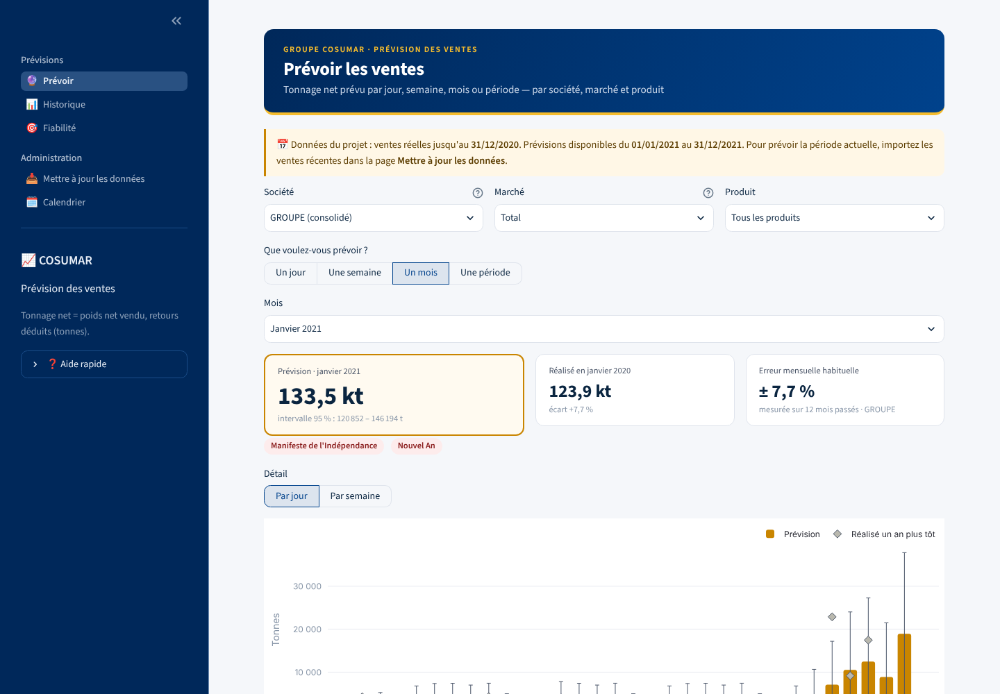
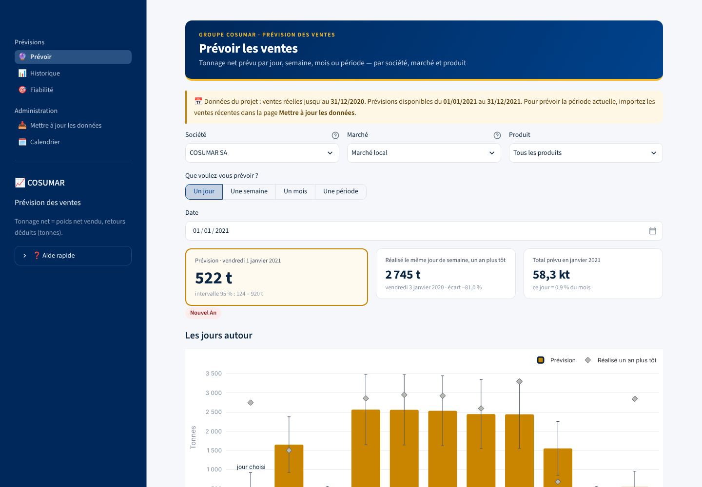
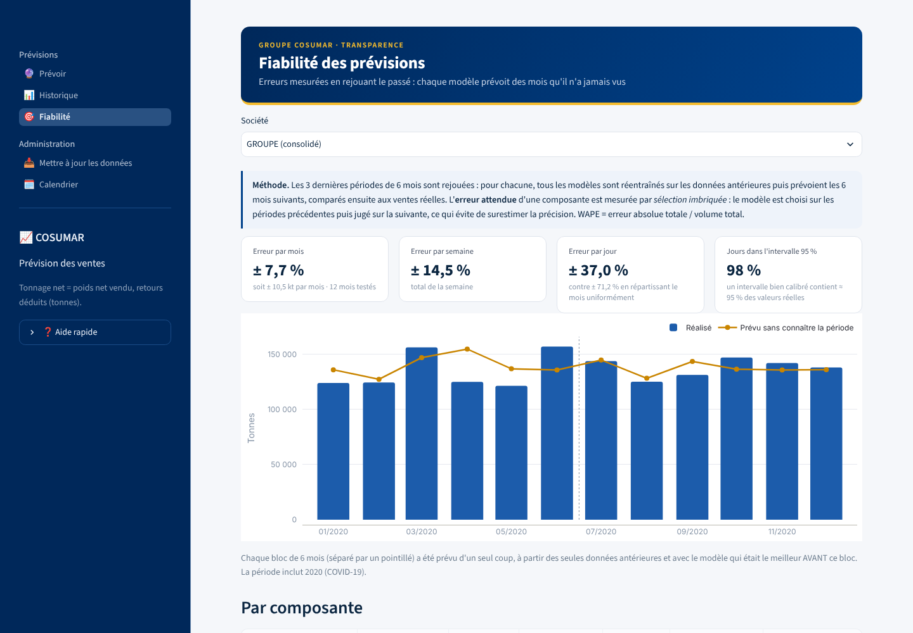

# 📈 COSUMAR — Prévision des ventes

Application **Streamlit** de prévision du **tonnage net vendu** (ventes − retours) par le groupe sucrier COSUMAR et ses filiales **SUNABEL**, **SURAC** et **SUTA** — **par jour, par semaine, par mois ou sur une période libre**, par **société**, **marché** (local / export) et **produit** (pain de sucre, lingot, morceau, granulé).

Projet de stage — analyse de séries temporelles et outil d'aide à la décision.



---

## Sommaire

1. [Ce que fait l'application](#1-ce-que-fait-lapplication)
2. [Guide d'utilisation](#2-guide-dutilisation)
3. [Méthode](#3-méthode)
4. [Fiabilité mesurée](#4-fiabilité-mesurée)
5. [Données et confidentialité](#5-données-et-confidentialité)
6. [Installation et déploiement](#6-installation-et-déploiement)
7. [Structure du code](#7-structure-du-code)
8. [Limites](#8-limites)

---

## 1. Ce que fait l'application

| Page | Usage |
|---|---|
| 🔮 **Prévoir** | Prévision d'**un jour**, **une semaine**, **un mois** ou **une période** (au jour, à la semaine ou au mois) avec intervalle à 95 %, comparaison au réalisé un an plus tôt, répartition par produit, export Excel / CSV. |
| 📊 **Historique** | Ventes réalisées sur n'importe quelle période, saisonnalité, profil par jour de la semaine, répartition par produit et par année. |
| 🎯 **Fiabilité** | Erreurs mesurées en rejouant le passé (mois, semaine, jour), calibration des intervalles, comparaison des modèles. |
| 📥 **Mettre à jour les données** | Import des nouvelles extractions SAP (CSV) → recalcul automatique des prévisions. |
| 🗓️ **Calendrier** | Jours fériés et Ramadan utilisés par les modèles, modifiables (dates religieuses à confirmer à l'annonce officielle). |

## 2. Guide d'utilisation

**Prévoir une journée, une semaine, un mois.**
1. Choisissez la **société** (ou *GROUPE (consolidé)*), le **marché** et le **produit**.
2. Choisissez *Un jour*, *Une semaine*, *Un mois* ou *Une période*, puis la date.
3. Lisez la prévision (en tonnes), son **intervalle à 95 %** et le **réalisé un an plus tôt** (même jour de la semaine).
4. Téléchargez le détail en Excel ou CSV.



**Prévoir la période actuelle.** Les données du dépôt s'arrêtent au 31/12/2020 : l'application prévoit donc 2021 et l'indique dans un bandeau. Pour prévoir aujourd'hui :

1. Exportez de SAP les lignes de facturation récentes (CSV, mêmes colonnes que l'extraction d'origine).
2. Page **Mettre à jour les données** → déposez le(s) fichier(s) → vérifiez le contrôle (période, tonnage, lignes ignorées) → **Appliquer et recalculer** (~20 s).
3. Toutes les pages utilisent alors les nouvelles données ; les prévisions démarrent au mois qui suit la dernière donnée complète.

Mode **Ajouter** : seuls les jours postérieurs aux données existantes sont pris (recharger une période ne crée pas de double comptage). Mode **Remplacer** : les fichiers importés remplacent tout.

Les données importées restent **dans la session**. Pour les conserver : bouton *Télécharger ventes_journalieres.csv*, remplacez `data/ventes_journalieres.csv` dans le dépôt, puis `python scripts/calculer_previsions.py`.

**Calendrier.** Les fêtes religieuses suivent l'observation du croissant lunaire : corrigez-les dans la page *Calendrier* dès l'annonce officielle (les dates 2017–2026 sont celles observées/annoncées, 2027–2028 sont estimées). Les prévisions ne vont pas au-delà du dernier Ramadan renseigné.

## 3. Méthode

### 3.1 Ce que montrent les données

L'analyse des 391 556 lignes de facturation 2017–2020 a guidé la conception :

| Constat | Conséquence |
|---|---|
| **38 % du tonnage de COSUMAR SA est exporté**, facturé par cargaisons, à **16×** la moyenne le dernier jour du mois (même un dimanche : clôture comptable). | Marché local et export sont **modélisés séparément**. |
| **Pic d'achats le mois précédant le Ramadan** (avril 2017, 2018, 2019 ; mars 2020), qui avance d'~11 jours par an. | Variables calendaires : part du mois en Ramadan, part du mois suivant en Ramadan, jours ouvrés. |
| **Dimanche ≈ 0**, samedi réduit ; **jours fériés ≈ 0** (vérifié sur les fêtes nationales et les deux Aïds). | Profil journalier par jour de semaine, jours fériés, fin de mois. |
| Retours = 15 % des lignes mais 0,3 % du tonnage. | Cible = **tonnage net**, pas nombre de lignes. |
| Extraction quasi vide certains mois (SURAC : 0, 6 et 2 lignes). | Mois marqués *incomplets* et interpolés, pas traités comme des mois sans vente. |

### 3.2 Chaîne de prévision

1. **Séries mensuelles** par composante (société × marché) : COSUMAR SA local, COSUMAR SA export, SUNABEL, SURAC, SUTA.
2. **10 modèles** évalués sur chaque composante :

   | Famille | Modèles |
   |---|---|
   | Références | naïf (mois précédent), naïf saisonnier (M-12), moyenne 12 mois |
   | Statistiques | SARIMA, **SARIMAX + calendrier**, Holt-Winters (ordres choisis par AIC sur l'entraînement uniquement) |
   | Calendrier | **Moyenne 12 mois + calendrier** (niveau × effet Ramadan / pré-Ramadan / jours ouvrés) |
   | Machine learning | Ridge + calendrier, Random Forest + calendrier (retards 1, 2, 3, 12 mois ; prévision récursive) |
   | Combinaison | moyenne fixée à l'avance de trois modèles |

3. **Validation à origine glissante** : 3 fenêtres de 6 mois (juillet 2019 → décembre 2020). Chaque modèle est réentraîné sur le passé et prévoit les 6 mois suivants **sans les voir** ; le modèle à la plus faible MAE est retenu.
4. **Erreur affichée = sélection imbriquée** : le modèle est choisi sur les fenêtres précédentes puis évalué sur la suivante. Choisir le meilleur parmi 10 sur la période même d'évaluation surestimerait la précision.
5. **Du mois au jour** : chaque total mensuel est réparti sur ses jours par un **profil journalier** (régression de Poisson : jour de semaine, 5 derniers jours calendaires et ouvrés du mois, fin de mois un jour non ouvré, fériés, lendemain de fête, Ramadan), estimé séparément pour chaque composante. Les jours d'un mois somment exactement à la prévision du mois.
6. **Produits** : répartition selon les parts des 12 derniers mois de chaque composante.
7. **Intervalles à 95 %** : incertitude du total mensuel σ(h) = c·√h (estimée sur les erreurs du backtest, croissante avec l'horizon) + variabilité de répartition jour à jour (surdispersion estimée sur l'historique ; elle s'annule sur un mois complet). Les composantes sont additionnées en supposant leurs erreurs indépendantes.

## 4. Fiabilité mesurée

Erreur en % du volume (WAPE = Σ|erreur| / Σ volume), sur les 12 derniers mois de test, modèle choisi sans connaître la période évaluée :

| Périmètre | Mois | Semaine | Jour | Jour (répartition uniforme) | Jours dans l'IC 95 % |
|---|---:|---:|---:|---:|---:|
| GROUPE (consolidé) | 7,7 % | 14,5 % | 37,0 % | 71,2 % | 98 % |
| COSUMAR SA | 8,2 % | 17,4 % | 43,5 % | 83,4 % | 98 % |
| SUNABEL | 38,9 % | 30,8 % | 37,3 % | 53,9 % | 93 % |
| SURAC | 33,9 % | 47,2 % | 53,6 % | 67,0 % | 96 % |
| SUTA | 21,9 % | 18,4 % | 28,6 % | 47,5 % | 96 % |



**Lecture :**
- Au niveau du groupe, la prévision mensuelle se trompe en moyenne de **± 7,7 %**, la prévision hebdomadaire de ± 14,5 %.
- Le **profil journalier divise l'erreur journalière par deux** par rapport à une répartition uniforme du mois (37 % contre 71 %).
- Les intervalles sont **bien calibrés** : 93 à 98 % des jours réels y tombent (cible 95 %).
- L'erreur journalière reste élevée pour l'export (cargaisons) et pour les petites sucreries : ces prévisions sont des **ordres de grandeur**.
- Avec 12 à 18 mois de test, les écarts entre bons modèles (≈ 1 point) ne sont **pas significatifs** ; au niveau groupe, toutes les stratégies testées (meilleur modèle, combinaison fixe, SARIMAX + calendrier, moyenne 12 mois) donnent entre 7,4 % et 8,5 %.
- La période de test inclut 2020 (**COVID-19**).

Tous ces chiffres sont recalculés par l'application à chaque mise à jour des données.

## 5. Données et confidentialité

| Fichier | Contenu |
|---|---|
| `data/ventes_journalieres.csv` | Tonnage net et nombre de lignes **par jour × société × marché × produit**. **Aucune donnée client.** |
| `data/calendrier_evenements.csv` | Jours fériés marocains et Ramadan 2017–2028. |
| `donnees_brutes/` *(exclu par .gitignore)* | Extractions SAP ligne par ligne : **contiennent des numéros de clients, ne jamais publier**. |

`python scripts/preparer_donnees.py` agrège les extractions brutes ; la même conversion est faite dans l'application à l'import (les colonnes clients ne sont pas lues). Unité du poids net : la tonne (ordre de grandeur cohérent avec les volumes du groupe). Avant toute publication, vérifiez avec l'entreprise que la diffusion des agrégats est autorisée.

## 6. Installation et déploiement

```bash
git clone https://github.com/<compte>/Cosumar.git
cd Cosumar
pip install -r requirements.txt
streamlit run app.py
```

**Streamlit Community Cloud** : *New app* → dépôt, branche `main`, fichier `app.py`, Python 3.11 ou plus récent. L'application s'ouvre instantanément grâce aux prévisions précalculées (`results/previsions.json`).

Après une modification de `data/` ou du calendrier dans le dépôt :

```bash
python scripts/calculer_previsions.py      # précalcul (~20 s)
pip install -r requirements-dev.txt && python -m pytest -q   # 14 tests
```

## 7. Structure du code

```
├── app.py                         # navigation et barre latérale
├── ui/
│   ├── commun.py                  # état de session, formatage français, graphiques, exports
│   ├── page_prevoir.py            # jour / semaine / mois / période
│   ├── page_historique.py
│   ├── page_fiabilite.py
│   ├── page_donnees.py            # import SAP, fusion, recalcul
│   └── page_calendrier.py
├── prevision/
│   ├── donnees.py                 # import SAP → agrégats anonymes, séries mensuelles, contrôles
│   ├── calendrier.py              # fériés, Ramadan, variables calendaires
│   ├── modeles.py                 # 10 modèles mensuels, backtest, métriques
│   └── moteur.py                  # sélection, profil journalier, agrégation, intervalles
├── scripts/
│   ├── preparer_donnees.py        # extractions brutes → data/ventes_journalieres.csv
│   └── calculer_previsions.py     # → results/previsions.json
├── data/  results/  tests/  docs/images/
├── requirements.txt  requirements-dev.txt
└── .streamlit/config.toml         # thème
```

## 8. Limites

- Historique de 4 ans (48 mois) : 18 mois de test seulement ; données jusqu'à décembre 2020 dans le dépôt.
- Les exportations dépendent de contrats et de cargaisons que l'historique seul ne peut pas anticiper : à compléter par le carnet de commandes export.
- Pas encore de variables de prix, de promotions, de campagnes sucrières ou de météo.
- Dates des fêtes religieuses futures estimées (± 1 jour) tant qu'elles ne sont pas annoncées.
- Prévisions statistiques indicatives, à recouper avec l'expertise des équipes commerciales et logistiques.
